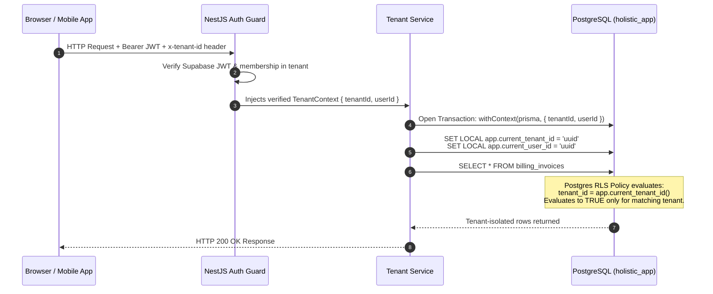
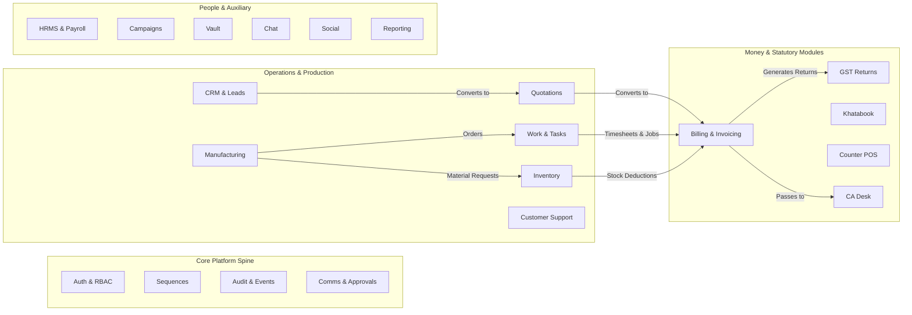
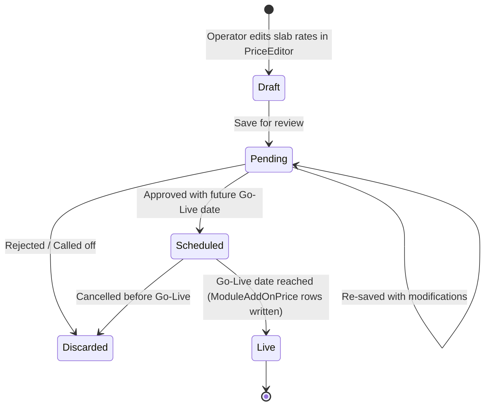

# Codozent One (Holistic) — Complete System Architecture & Rebuilding Blueprint

> **Document Type:** System Architecture Document (SAD) / Software Requirement Specification (SRS) / Engineering Handover Blueprint  
> **Target Audience:** CTOs, Lead Architects, Full-Stack Engineers, Product Managers  
> **Codename:** markettoo
> **Version:** 1.0 (Production Release / Enterprise Grade)  
> **Jurisdiction / Focus:** Indian MSMEs (Micro, Small & Medium Enterprises)  

---

## 1. Executive Summary & Product Vision

### 1.1 What is "Codozent One"?
**Codozent One** (internally codenamed **Holistic**) is an enterprise-grade, multi-tenant, modular, AI-native ERP and business operating system purpose-built for Indian Micro, Small, and Medium Enterprises (MSMEs). 

Most Indian MSMEs currently operate using a fragmented patchwork of disconnected tools:
- **Tally / Busy** for accounting (desktop-locked, inaccessible on mobile, no native collaboration).
- **WhatsApp & Paper Diaries** for daily communications, order tracking, and approvals.
- **Excel sheets** for leads, inventory, and payroll.
- **Khata Book / OkCredit** apps for basic udhar tracking.

**Codozent One** consolidates all of these into a unified, modular web and mobile platform where:
1. **Zero Training Required:** Designed for first-time business software users. Intuitive UI, local languages (English, Hindi, Marathi), and native WhatsApp-first workflows.
2. **Modular Marketplace:** Rather than forcing businesses into a bloated, monolithic ERP, the platform offers discrete business modules (Billing, CRM, Inventory, Khata Book, GST Returns, HRMS, Manufacturing, etc.) that can be purchased and activated individually or as pre-configured "Industry Packs" (e.g. for Garment Manufacturers, Wholesalers, Fabrication, Agencies).
3. **Inter-Module Capability Seams:** Modules are completely decoupled. When a business activates both *Work* and *Billing*, Billing automatically discovers the ability to invoice completed tasks or projects without either module importing code from the other.
4. **WhatsApp-Native Operations:** Business owners can receive daily summaries, approve discounts, authorise purchase orders, and interact with the system directly via WhatsApp numbered replies without ever logging into the web app.
5. **AI-Native Assistant & Automation:** A multi-model AI assistant with voice dictation and permission-scoped tool calling allows owners to ask *"Iss mahine kiska payment baki hai?"* or *"Sharma ji ko 50,000 ka quote bhej do"* safely and reliably.

### 1.2 Commercial & Pricing Model
- **Commercial Model:** B2B SaaS, charged **per user, per month or year**.
- **Seat-Slab Ladder:** Rates step down automatically as team size expands (e.g., 1–4 seats @ ₹599/user, 5–20 seats @ ₹509/user, 21+ seats @ ₹449/user).
- **Trial & Billing:** 14-day no-card trial, with deferred mandate/autopay setup. **No permanent free tier**.
- **Indian Statutory Compliance:** 18% Platform GST, automated Indian financial year calendar (1st April – 31st March), gapless sequential invoices (`INV-2026-0001`), HSN/SAC directory, and direct WhiteBooks GSP integration for automated GSTR-1, GSTR-3B, E-Invoicing (IRN), and E-Way Bills.

---

## 2. High-Level Architecture & Core Principles

```mermaid
flowchart TB
    subgraph ClientLayer ["Client Layer"]
        Web["Next.js 16 Web App (App Router, React 19)"]
        Mobile["Expo 55 / React Native Mobile App"]
        WhatsAppUser["WhatsApp Inbound / Outbound (Meta / REST BSP)"]
        Agents["AI Agents / External API Consumers"]
    end

    subgraph GatewayLayer ["Reverse Proxy & Gateway"]
        Caddy["Caddy Reverse Proxy (TLS Termination)"]
    end

    subgraph ServiceLayer ["Application Services (Dual-Process Monolith)"]
        API["NestJS 11 HTTP API (/api, /platform, /agent, /portal)"]
        Worker["NestJS 11 Worker Process (BullMQ Consumers & Cron Jobs)"]
    end

    subgraph DataLayer ["Data & State Infrastructure"]
        PgBouncer["PgBouncer (Transaction Pooling :6442)"]
        Postgres[("PostgreSQL 17 (Host :5442 / Force RLS)")]
        Redis[("Redis 7 (BullMQ, Caching, MFA Proofs)")]
        Gotenberg["Gotenberg 8 (Headless Chromium PDF)"]
        MinIO["MinIO / Cloudflare R2 (S3-Compatible Object Store)"]
    end

    Web -->|HTTPS same-origin| Caddy
    Mobile -->|HTTPS REST| Caddy
    WhatsAppUser -->|Webhook| Caddy
    Agents -->|Scoped API Key| Caddy

    Caddy -->|Proxy /| Web
    Caddy -->|Proxy /api| API

    API -->|Tenant / RLS Connection| PgBouncer
    API -->|Platform Connection (BYPASSRLS)| PgBouncer
    API -->|Enqueue Jobs / Tokens| Redis
    API -->|Presigned URLs| MinIO

    Worker -->|Consume Queues| Redis
    Worker -->|Background Processing| PgBouncer
    Worker -->|Render HTML to PDF| Gotenberg
    Worker -->|Store Exports & Backups| MinIO

    PgBouncer --> Postgres
```

### 2.1 The Three Core Architectural Convictions
1. **The System of Record is the Product:**
   - Audit trail, events, and data integrity are not afterthought plumbing.
   - Every mutation is intercepted automatically (`AuditInterceptor`).
   - Append-only tables (`events`, `audit_log`, `activities`, `approval_actions`, `agent_tool_invocations`) have `REVOKE UPDATE, DELETE FROM holistic_app`. No code path or human can alter historical facts.
   - Core invariants are enforced at the database layer using PostgreSQL triggers (e.g., a company can never lose its last Owner via `app.enforce_last_owner()`; system roles cannot be deleted via `app.protect_system_roles()`).
2. **WhatsApp-Native Operations:**
   - Operations are bidirectional. Reply tokens turn outbound notifications into interactive control surfaces.
   - Approvals sent via WhatsApp can be confirmed with single-digit replies (`1: Approve`, `2: Reject`), which instantly fire events on the internal bus.
3. **AI-Agent-Ready:**
   - External LLMs and internal agents authenticate with standard scoped API keys (`ActorType.AGENT`).
   - The `/agent/tools` endpoint dynamically filters tool definitions according to the caller's assigned roles and tenant module activations. Agents cannot even see tools they lack permissions to execute.

### 2.2 Strict Multi-Tenancy & Database Security (Row-Level Security)
The platform enforces absolute tenant isolation at the PostgreSQL layer using native **Row Level Security (RLS)**.



#### Four Dedicated Database Credentials:
PostgreSQL exempts the table owner from RLS unless explicitly forced. The platform utilizes four distinct database connection credentials:
1. `holistic_migrator` (User for `DIRECT_DATABASE_URL`): Schema owner. Runs migrations. Subject to policies via `FORCE ROW LEVEL SECURITY`.
2. `holistic_app` (User for runtime `DATABASE_URL`): Used by NestJS HTTP API and worker for tenant operations. Strictly subject to RLS (`NOBYPASSRLS`).
3. `holistic_platform` (User for `PLATFORM_DATABASE_URL`): Used **exclusively** by the `/platform` super-admin console. Has `BYPASSRLS` privileges to manage cross-tenant subscriptions, catalogue, and system settings.
4. `holistic_backup` (User for `BACKUP_DATABASE_URL`): Used by `pg_dump`. Has `BYPASSRLS` and `SELECT` only.

#### Transaction-Scoped Context (GUCs):
In connection-pooled environments (PgBouncer), session-level variables survive request termination. Thus, RLS variables are applied **strictly per transaction** using:
```sql
SELECT set_config('app.current_tenant_id', $1, true);
SELECT set_config('app.current_user_id', $2, true);
```
If context is omitted, `current_setting('app.current_tenant_id', true)` evaluates to `NULL`, resulting in a safe default-deny (zero rows returned).

---

## 3. Technology Stack Reference

| Layer | Technology | Version | Purpose & Architectural Justification |
| :--- | :--- | :--- | :--- |
| **Backend Framework** | **NestJS** | `11.1.28` | Modular architecture, dependency injection, enterprise structure |
| **Language & Engine** | **TypeScript & Node.js** | `TS 5.9.3`, `Node >= 22` | Strict typing (`noUncheckedIndexedAccess`), modern ECMAScript |
| **Database ORM** | **Prisma** | `7.9.1` | Type-safe schema generation (`@prisma/adapter-pg` driver adapter) |
| **Primary Database** | **PostgreSQL** | `17` | Relational integrity, JSONB, native Row-Level Security, custom GUCs |
| **Connection Pooler** | **PgBouncer** | Latest Alpine | Transaction pooling (`:6442`), scales concurrent DB connections |
| **Message Broker** | **BullMQ & Redis** | `BullMQ 6.0`, `Redis 7` | Distributed queues, async jobs, MFA verification proofs, caching |
| **Frontend Framework** | **Next.js (App Router)** | `16.3` / `16.4` | Server Components (RSC), SSR, Route Groups, Edge readiness |
| **UI Library** | **React** | `19.2.8` (Pinned) | Modern hooks, Actions, Server/Client component isolation |
| **Data Fetching** | **TanStack Query** | `5.62.7` | Client-side caching, background refetching, mutation states |
| **Client State** | **Zustand** | `5.0.3` | Lightweight auth token and per-tab tenant session persistence |
| **Styling** | **Tailwind CSS** | `4.3.3` | Utility-first CSS, responsive design tokens, dark mode |
| **Internationalization**| **next-intl** | `4.x` | Multi-lingual support: English (`en`), Hindi (`hi`), Marathi (`mr`) |
| **Mobile App** | **Expo / React Native** | `Expo 55`, `RN 0.81` | Cross-platform iOS/Android app sharing schemas with web |
| **PDF Generation** | **Gotenberg** | `8` | Headless Chromium engine converting HTML/CSS into crisp PDFs |
| **File Storage** | **MinIO / Cloudflare R2**| S3-Compatible | Object store for scans, attachments, invoice PDFs, and backups |
| **Reverse Proxy** | **Caddy** | Latest Alpine | Automated Let's Encrypt TLS termination, same-origin API proxying |
| **Payment Gateways** | **Razorpay & Cashfree** | Production APIs | Recurring subscription mandates, UPI autopay, one-off checkout |
| **GST GSP Provider** | **WhiteBooks API** | Sandbox & Prod | GSTR-1, GSTR-3B filing, 2B reconciliation, IRN E-Invoicing |
| **Authentication** | **Supabase Auth** | ES256 / JWKS | JWT token issuer, OAuth (Google), email/password, local HS256 shim |

---

## 4. Repository & Monorepo Structure

```
Houseofmsme-main/
├── apps/
│   ├── api/                     # NestJS 11 Backend API & Background Workers
│   │   ├── src/
│   │   │   ├── accounts/        # Tenant account lifecycle & workspace binding
│   │   │   ├── agent/           # AI Agent tool registry & execution engine
│   │   │   ├── assistant/       # AI Assistant (chat, speech dictation, model router)
│   │   │   ├── auth/            # Supabase JWT verification, Realm guards, MFA, OTP
│   │   │   ├── common/          # Audit interceptor, Redis, logger, request context
│   │   │   ├── core/            # Cross-cutting platform engines (approvals, comms, gst, pdf, sequences)
│   │   │   ├── modules/         # 17 Installed business modules (code-based)
│   │   │   ├── modules-registry/# Central module manifests & provider definitions
│   │   │   ├── nocode/          # Dynamic JSONB-driven no-code module engine
│   │   │   ├── platform/        # Operator super-admin console backend & billing engine
│   │   │   ├── portal/          # Public links backend (invoices, quotes, balance confirmations)
│   │   │   ├── rbac/            # Permission registry, roles, and scope validators
│   │   │   ├── tenancy/         # Customer onboarding, checkout, dashboard APIs
│   │   │   ├── main.ts          # HTTP API entrypoint (:4000)
│   │   │   └── worker.main.ts   # BullMQ worker entrypoint (background jobs)
│   ├── web/                     # Next.js 16 Web Application
│   │   ├── src/
│   │   │   ├── app/
│   │   │   │   ├── (marketing)/ # Public site (Landing page, /modules, /pricing, /industries)
│   │   │   │   ├── (platform)/  # Operator super-admin portal (/platform)
│   │   │   │   ├── (tenant)/    # Signed-in workspace (/m/[module], settings, dashboard)
│   │   │   │   ├── (portal)/    # Public customer portals (invoices, quotes, approvals)
│   │   │   │   ├── onboarding/  # Multi-step business setup & checkout wizard
│   │   │   │   ├── login/       # Authentication (Email, Google, Mobile OTP)
│   │   │   ├── components/      # UI components, screen renderers, assistant panel
│   │   │   ├── i18n/            # Internationalization dictionaries (en.json, hi.json, mr.json)
│   │   │   └── lib/             # API client, Zustand session, pricing math, money formatters
│   └── mobile/                  # Expo SDK 55 Mobile App
├── packages/
│   ├── database/                # Prisma schema (270 models), 219 SQL migrations, RLS policies
│   ├── module-sdk/              # Manifest contracts, decorators, tokens, capability interfaces
│   ├── types/                   # Shared TypeScript definitions, DTOs, Zod validation schemas
│   └── ui/                      # Shared React UI components (DataTable, CommandBar, Timeline)
├── deploy/                      # Docker Compose prod, Caddyfile, systemd scripts, PgBouncer config
├── docker/                      # Local dev services (Postgres init, PgBouncer, Gotenberg, Mailhog)
├── docs/                        # In-depth architectural runbooks and audit logs
└── scripts/                     # setup.sh, verify.sh, ship-api.sh, ship-web.sh, backup.sh
```

---

## 5. Comprehensive Module-by-Module Specification

The platform contains **17 production business modules** plus a **No-Code Module Builder**. Every module implements the `@holistic/module-sdk` contract.



### Module 1: Billing & Invoicing (`billing`)
- **Primary Persona:** Business Owner, Accountant, Billing Clerk.
- **Purpose:** End-to-end sales and purchase billing compliant with Indian GST rules.
- **Key Prisma Models:** `BillingInvoice`, `BillingInvoiceLine`, `BillingPurchase`, `BillingPurchaseLine`, `BillingPayment`, `BillingSalesDocument`, `BillingSchedule` (recurring), `BillingEwayBill`, `BillingDocumentScan`, `BillingRfq`, `BillingGoodsReceipt`, `BillingVendorSupply`.
- **Key Capabilities & Features:**
  - **Invoicing:** Gapless series (`INV-2026-0001`), CGST/SGST/IGST breakdown, HSN/SAC lookups, reverse charge, TDS/TCS.
  - **Purchase Management:** PO generation, RFQs, vendor comparisons, GRN (Goods Receipt Notes), 3-way matching (PO vs GRN vs Invoice).
  - **Delivery & Reminders:** Automated WhatsApp/Email invoice dispatch with payment links; automated reminder cadence for overdue receivables.
  - **E-Invoicing & E-Way Bills:** Direct generation via WhiteBooks GSP without leaving the dashboard.
  - **Audit & Leakage Detection:** Detects duplicate vendor bills, missed input tax credits (ITC), and overdue MSME 45-day payment limits.
  - **Tally Sync:** One-click XML export compatible with Tally Prime / ERP 9.
- **Screens:** `BillingInvoices`, `BillingPurchases`, `BillingReceivables`, `BillingPayables`, `BillingOrders`, `BillingOrderBoard`, `BillingOrderDetail`, `BillingRfqDetail`, `BillingVendors`, `BillingScanReview`.
- **AI Agent Tools:** `billing_list_invoices`, `billing_get_invoice`, `billing_create_invoice`, `billing_record_payment`, `billing_get_outstanding`.

### Module 2: CRM & Lead Management (`crm`)
- **Primary Persona:** Sales Head, Business Development Executive, Telecaller.
- **Purpose:** Omnichannel lead capture, pipeline management, automated follow-up sequences, and ROI attribution.
- **Key Prisma Models:** `CrmLead`, `CrmLeadContact`, `CrmLeadConsent`, `CrmPipeline`, `CrmPipelineStage`, `CrmSequence`, `CrmFollowUp`, `CrmAdCredential`, `CrmIntakeLink`.
- **Key Capabilities & Features:**
  - **Intake & Webhooks:** Instant capture from Meta Lead Ads, Google Ads, IndiaMART, JustDial, and website forms.
  - **Pipelines:** Multi-stage Kanban boards with custom stages, deal values, and win probabilities.
  - **Automated Sequences:** WhatsApp and email follow-up drips triggered by stage transitions or inactivity.
  - **Lead Scoring & Presence:** Tracks lead activity, interactions, and assignees' response time.
  - **DPDP Act Compliance:** Digital Personal Data Protection Act compliance tracking user consent and opt-outs.
- **Screens:** `CrmLeads`, `CrmLeadDetail`, `CrmInbox`, `CrmInsights`, `CrmRoi`, `CrmSequences`, `CrmToday`, `LeadFollowUps`, `LeadsImportExport`.
- **AI Agent Tools:** `crm_search_leads`, `crm_create_lead`, `crm_update_stage`, `crm_add_note`, `crm_schedule_followup`.

### Module 3: Work & Project Management (`work`)
- **Primary Persona:** Operations Manager, Project Lead, Agency Founder.
- **Purpose:** Client deliverables, project milestones, internal tasks, time tracking, and labour cost management.
- **Key Prisma Models:** `WorkProject`, `WorkTask`, `WorkDeliverable`, `WorkMeeting`, `WorkLabourRate`, `WorkTimeEntry`, `WorkTemplate`, `WorkType`.
- **Key Capabilities & Features:**
  - **Task & Kanban Boards:** Sprint planning, task assignment, due dates, priority labels, checklist items.
  - **Labour & Cost Tracking:** Timesheets linked to hourly rates and state minimum wage reference guidelines.
  - **Client Collaboration:** Controlled portal access for external clients to view deliverables and approve milestones.
  - **Meeting Notes & Integration:** Agendas, action items, and automated calendar sync.
- **Screens:** `WorkProjects`, `WorkProjectDetail`, `WorkTasks`, `WorkTaskDetail`, `WorkBoard`, `WorkCalendar`, `WorkTimesheet`, `WorkCosts`, `WorkTemplates`.
- **AI Agent Tools:** `work_list_tasks`, `work_create_task`, `work_complete_task`, `work_log_time`, `work_project_summary`.

### Module 4: Quotations & Estimates (`quotations`)
- **Primary Persona:** Estimator, Sales Representative, Proprietor.
- **Purpose:** Professional quotation creation, multi-version tracking, and conversion to active projects or invoices.
- **Key Prisma Models:** `Quotation`, `QuotationLine`, `QuotationItemLeadTime`, `AgencyProfile`.
- **Key Capabilities & Features:**
  - **Interactive Estimator:** Line-item costing based on item catalogues, labour rates, and markups.
  - **Version Control:** Revision history (`QUO-001-v1`, `v2`) ensuring clarity on negotiated terms.
  - **Staged Payment Terms:** Milestone-based billing schedules defined directly on the quote.
  - **One-Click Conversion:** Seamless conversion of approved quotes into confirmed sales orders or tax invoices.
- **Screens:** `Quotations`, `QuotationDetail`, `QuotationTemplates`, `QuotationPaymentStages`, `QuotationProfile`.
- **AI Agent Tools:** `quotation_list`, `quotation_get`, `quotation_create`, `quotation_convert_to_invoice`.

### Module 5: Khatabook (Udhar & Cash Book) (`khatabook`)
- **Primary Persona:** Traditional Trader, Retailer, Shop Owner.
- **Purpose:** Digital ledger book for tracking daily credit (Jama/Udhar) with customers and suppliers.
- **Key Prisma Models:** `KhataJournal`, `KhataJournalLine`, `KhataEntry`, `MoneyAccount`, `MoneyTransfer`, `BooksClosing`, `BankStatementLine`, `FixedAsset`, `BudgetLine`.
- **Key Capabilities & Features:**
  - **Digital Daybook:** Daily cash and bank register with opening and closing balance calculations.
  - **Party Ledgers:** Customer and vendor ledger accounts showing running balances and payment aging.
  - **Payment Reminders:** Automated WhatsApp reminders with UPI payment links to collect pending udhar.
  - **Bank Reconciliation:** Upload bank statements (CSV/Excel) and match transactions against journal lines.
- **Screens:** `Khatabook`, `KhatabookAccounts`, `KhatabookAssets`, `KhatabookBank`, `KhatabookBudgets`, `KhatabookCashBank`, `KhatabookCashFlow`.
- **AI Agent Tools:** `khatabook_get_party_balance`, `khatabook_record_entry`, `khatabook_daily_summary`.

### Module 6: GST Returns & Compliance (`gstReturns`)
- **Primary Persona:** In-house Accountant, Tax Consultant.
- **Purpose:** Direct GST filing, input tax credit (ITC) reconciliation, and audit preparation.
- **Key Prisma Models:** `GstReturnFiling`, `GstItcReversal`, `GstItcDecision`, `TaxChallan`, `TaxStatementFiling`.
- **Key Capabilities & Features:**
  - **GSTR-1 Preparation:** Auto-populates B2B, B2C, Exports, and CDN tables from issued invoices.
  - **GSTR-2B Matching:** Compares purchases against auto-drafted GSTR-2B data from the GST portal to flag mismatched or missing supplier invoices.
  - **Section 16(4) & Rule 37 Compliance:** Automated tracking of unpaid supplier bills over 180 days requiring ITC reversal.
  - **GSTR-3B Auto-Computation:** Calculation of net tax payable, cash ledger offsets, and tax challan creation.
- **Screens:** `GstReturns`, `GstItcRegister`, `GstTwoBMatch`.
- **AI Agent Tools:** `gst_reconcile_2b`, `gst_compute_liability`, `gst_get_filing_status`.

### Module 7: CA Desk (Auditor & CA Collaboration) (`caDesk`)
- **Primary Persona:** External Chartered Accountant (CA), Tax Auditor.
- **Purpose:** Dedicated collaboration desk for CAs to review company accounts without granting operational access.
- **Key Prisma Models:** `ScheduleIiiMapping`, `YearEndCheck`, `OwnerQuestion`, `BooksReadingPreference`, `BillingBalanceConfirmation`.
- **Key Capabilities & Features:**
  - **Schedule III Financial Statements:** Auto-mapped Balance Sheet and Profit & Loss statements ready for statutory filing.
  - **Year-End Audit Checklist:** Fixed asset depreciation, stock valuation, bank confirmation reconciliations.
  - **MSME 45-Day Payment Scrutiny:** Scrutiny of micro/small enterprise dues under Section 43B(h) of the Income Tax Act.
  - **Audit Queries Desk:** In-app structured Q&A between the CA and the business owner with file attachments.
- **Screens:** `CaDeskScheduleIii`, `CaDeskStatements`, `CaDeskMsme`, `CaDeskQuestions`, `CaDeskTds`, `CaDeskYearEnd`.
- **AI Agent Tools:** `ca_desk_list_queries`, `ca_desk_get_schedule_iii_summary`.

### Module 8: Counter / Point of Sale (`counter`)
- **Primary Persona:** Cashier, Store Clerk.
- **Purpose:** High-speed retail counter billing, barcode scanning, and instant thermal receipt printing.
- **Key Prisma Models:** `CounterSale`, `MoneyAccount`.
- **Key Capabilities & Features:**
  - **Fast Billing Interface:** Keyboard-driven, barcode scanner compatible, sub-second item addition.
  - **Split Payments:** Accepts cash, UPI QR codes, debit/credit cards, and store credit on a single bill.
  - **Offline-Resilient:** Operates through transient connectivity drops and syncs once reconnected.
  - **Cash Drawer Reconcile:** Shift open/close balancing with physical cash counting records.
- **Screens:** `CounterDesk`.

### Module 9: Inventory & Warehouse Management (`inventory`)
- **Primary Persona:** Warehouse Manager, Inventory Controller.
- **Purpose:** Multi-location stock tracking, batch/serial tracking, reorder automation, and valuations.
- **Key Prisma Models:** `InventoryItem`, `InventoryLocation`, `InventoryMovement`, `InventorySerial`, `InventorySerialEvent`, `InventoryItemPartyPrice`.
- **Key Capabilities & Features:**
  - **Multi-Warehouse:** Real-time stock levels across branches, go-downs, and transit locations.
  - **Batch & Serial Traceability:** Complete genealogy tracking from raw material intake to customer dispatch.
  - **Auto-Reorder Engine:** Low-stock threshold alerts with one-click RFQ or Purchase Order generation.
  - **Valuation Methods:** FIFO (First-In, First-Out) and Weighted Average Costing compliant with Ind AS 2.
- **Screens:** `InventoryStock`, `InventoryTrace`, `inventory-count`.
- **AI Agent Tools:** `inventory_check_stock`, `inventory_record_movement`, `inventory_low_stock_report`.

### Module 10: Manufacturing & Production (`manufacturing`)
- **Primary Persona:** Plant Head, Production Supervisor, Quality Engineer.
- **Purpose:** Bill of Materials (BOM), production scheduling, shop-floor execution, job cards, and job-work tracking.
- **Key Prisma Models:** `ManufacturingBom`, `ManufacturingBomLine`, `ManufacturingOrder`, `ManufacturingOrderCostPlan`, `ManufacturingJobStage`, `ManufacturingJobCard`, `ManufacturingJobWork`, `ManufacturingMachine`, `ManufacturingQualityCheck`, `ManufacturingRejection`.
- **Key Capabilities & Features:**
  - **Multi-Level BOM:** Detailed recipe costing including raw materials, consumables, scrap recovery, and machine time.
  - **Shop Floor Job Cards:** Printable routing cards with stage-wise tracking (Cutting, Lathe, Welding, Assembly, Finishing).
  - **Machine Downtime & OEE:** Maintenance logging and capacity utilization metrics.
  - **Job-Work (Subcontracting):** GST Annexure-V challans for materials sent to third-party processors.
  - **Quality Inspection:** Template-driven dimensional and functional QC checks with rejection root-cause analysis.
- **Screens:** `ManufacturingBoms`, `ManufacturingBomDetail`, `ManufacturingOrders`, `ManufacturingOrderDetail`, `ManufacturingJobCard`, `ManufacturingJobWork`, `ManufacturingMachines`, `ManufacturingQuality`, `ManufacturingRejections`, `ManufacturingFloorReports`.

### Module 11: HRMS & Payroll (`hrms`)
- **Primary Persona:** HR Executive, Payroll Admin.
- **Purpose:** Indian statutory payroll processing, biometric/mobile attendance, leave management, and employee records.
- **Key Prisma Models:** `HrmsEmployee`, `HrmsShift`, `HrmsSalaryStructure`, `HrmsAttendance`, `HrmsAttendanceLock`, `HrmsLeaveType`, `HrmsLeaveRequest`, `HrmsPayrollRun`, `HrmsPayslip`, `HrmsAdvance`.
- **Key Capabilities & Features:**
  - **Indian Statutory Payroll:** Automated computation of Basic, HRA, PF (Provident Fund), ESI, Professional Tax (state-wise), and TDS.
  - **Attendance Management:** Shift rosters, overtime calculations, late-coming penalties, and biometric log syncing.
  - **Salary Advances & Loans:** Disbursal tracking and monthly EMI deductions from payroll.
  - **Payslips & Disbursal:** One-click bulk PDF payslip generation and bank NEFT transfer files.
- **Screens:** `HrmsHome`, `HrmsEmployees`, `HrmsAttendance`, `HrmsLeave`, `HrmsPayroll`, `HrmsSetup`, `HrmsMe`.

### Module 12: Customer Support Desk (`support`)
- **Primary Persona:** Support Agent, Operations Coordinator.
- **Purpose:** Ticketing system with multi-channel intake (Email, WhatsApp, Portal), SLAs, and canned responses.
- **Key Prisma Models:** `SupportTicket`, `SupportTicketMessage`, `SupportCannedReply`.
- **Key Capabilities & Features:** Ticket routing, priority SLA clocks, customer glance context, internal private notes.
- **Screens:** `SupportTickets`, `SupportTicketDetail`, `SupportCannedReplies`.
- **AI Agent Tools:** `support_list_tickets`, `support_reply_ticket`, `support_close_ticket`.

### Auxiliary Modules:
- **Module 13: Campaigns & Ad Spend (`campaigns`):** Meta/Google ad spend ledger, campaign ROI tracking (`Campaign`, `CampaignLedgerEntry`).
- **Module 14: Vault (`vault`):** Secure password and encrypted credential management for company logins (`VaultCredential`).
- **Module 15: Chat (`chat`):** Internal peer-to-peer and channel team communication (`Message`).
- **Module 16: Social (`social`):** Social media scheduler, content calendar, and publishing across Facebook, Instagram, LinkedIn (`SocialPost`, `SocialChannel`).
- **Module 17: Reporting & BI (`reporting`):** Custom metric definitions, cross-module KPI dashboards, scheduled PDF digests (`ReportingMetric`, `ReportSchedule`).
- **No-Code Module Builder (`nocode`):** Allows platform operators to define custom business entities via JSONB schema without database DDL migrations (`NocodeModule`, `NocodeRecord`).

---

## 6. Cross-Cutting Systems & Core Platform Engines

### 6.1 Dynamic RBAC & Scoped Visibility
Authorization operates on three distinct layers:
1. **Tenant Isolation:** Enforced strictly via PostgreSQL RLS.
2. **Permission Check:** Gated by `@RequirePermission('module.resource.action')` on API endpoints.
3. **Visibility Scope:** Determines data visibility width:
   - `own`: User only views records they created (`owner_user_id = current_user_id`).
   - `team`: User views records belonging to their assigned team department.
   - `all`: User views all tenant records.
   *Enforcement Rule:* Scope is handled at `ScopedPrismaService`. A role cannot grant wider visibility or permissions than the grantor holds (`RolesService.assertCanGrant`).

### 6.2 Gapless Sequential Numbering System
Indian statutory compliance requires that invoices, debit notes, and credit notes contain zero gaps in numbering.
- **Mechanisms:** `SequenceDefinition` and `SequenceCounter`.
- **Formula:** Prefix + Financial Year + Padded Counter (e.g. `INV-2026-0001`).
- **Concurrency Protection:** PostgreSQL `SELECT ... FOR UPDATE` row-level locks on `SequenceCounter` inside the issuing transaction ensure two parallel checkout requests never obtain identical or skipped numbers.

### 6.3 Omnichannel Communications & WhatsApp Reply Tokens
- **Abstract Providers:** Outbound channels (WhatsApp, SMS, Email) are provider-agnostic.
- **WhatsApp Support:** Meta Cloud API or any generic REST BSP via HTTP config (`WHATSAPP_PROVIDER=meta|http|mock`).
- **SMS DLT Handling:** Full compliance with Indian TRAI DLT regulations (`EntityId`, `DLTTemplateId`, `SenderID`).
- **Reply Tokens:** When an approval prompt is dispatched over WhatsApp (e.g., *"Invoice #1024 ₹85,000 pending approval. Reply 1 to Approve, 2 to Reject"*), a secure token is registered in `WhatsAppReplyToken`. Inbound webhooks resolve this token and trigger the corresponding approval event.

### 6.4 Immutable Audit Trail & Timeline
- `AuditInterceptor` captures all `POST`, `PUT`, `PATCH`, `DELETE` operations.
- Appends changes to `audit_log` with before/after diffs, IP address, user-agent, and `actor_type` (`user` vs `agent`).
- `TimelineService` synthesizes audit diffs, activities, and system events into a single unified chronological timeline for any record.

### 6.5 AI Assistant & Multi-Model Router
- **Multi-Provider Architecture:** Routes requests across OpenAI, Anthropic, Google Gemini, and Groq based on cost, latency, and availability.
- **Agent Tool Calling:** Exposes business tools (`AgentToolRegistry`) with strict schema validation.
- **Safety Policies:** Destructive operations (e.g. deleting items or confirming high-value invoices) generate signed `ActionTokens` requiring explicit user confirmation before execution.
- **Voice Support:** Built-in audio dictation with regional dialect processing.

### 6.6 Commercial Engine: Pricing, Quotes & Subscriptions
- **Seat Slab Ladder:** Stored in `ModuleAddOnPrice`.
- **Server-Side Quote Engine (`quote.service.ts`):** Calculates exact billing based on headcount, selected modules, and billing interval (monthly/annual). The client never computes prices independently.
- **Price Review Workflow:** Operator price adjustments enter a `pending` state and must pass through an approval queue (`price-changes.service.ts`) before becoming `scheduled` or `live`.



---

## 7. Database Architecture & Data Dictionary Blueprint

The database comprises **270 models** organized into logical clusters:

```
Database Schema Clusters
├── 1. Platform & Operators (PlatformUser, PlatformAuditLog, ImpersonationSession, PlatformBillingSettings, Package, ModuleAddOnPrice, Coupon)
├── 2. Tenancy & RBAC (Tenant, User, TenantMembership, Role, RolePermission, Team, Invitation, UserSecurity, AuthEvent)
├── 3. Core Framework (Event, EventDelivery, Activity, Document, SequenceDefinition, SequenceCounter, CustomFieldDefinition, WhatsAppReplyToken)
├── 4. Invoicing & Billing (BillingInvoice, BillingInvoiceLine, BillingPayment, BillingPurchase, BillingSalesDocument, BillingEwayBill, BillingRfq)
├── 5. Accounting & Ledger (KhataJournal, KhataEntry, MoneyAccount, MoneyTransfer, BankStatementLine, BooksClosing)
├── 6. GST & Statutory (GstReturnFiling, GstItcReversal, GstItcDecision, TaxChallan, TaxStatementFiling, ScheduleIiiMapping)
├── 7. CRM & Marketing (CrmLead, CrmLeadContact, CrmPipeline, CrmPipelineStage, CrmSequence, Campaign, CampaignLedgerEntry)
├── 8. Manufacturing & Plant (ManufacturingBom, ManufacturingOrder, ManufacturingJobCard, ManufacturingJobWork, ManufacturingMachine, ManufacturingQualityCheck)
├── 9. Inventory & Stock (InventoryItem, InventoryLocation, InventoryMovement, InventorySerial)
├── 10. HRMS & Payroll (HrmsEmployee, HrmsShift, HrmsSalaryStructure, HrmsAttendance, HrmsLeaveRequest, HrmsPayrollRun, HrmsPayslip)
└── 11. Support & AI (SupportTicket, SupportTicketMessage, AssistantRequest, AssistantActionGrant, AgentToolInvocation)
```

### Essential Database Triggers:
1. `app.enforce_last_owner()`: Prevents deletion or role-demotion of the sole remaining Owner of a tenant.
2. `app.protect_system_roles()`: Protects predefined system roles (Owner, Admin) from deletion or modification.
3. `app.books_locked()`: Blocks changes to accounting journals for closed financial years.
4. `documents_storage_meter()`: Automatically computes and increments `TenantStorageUsage` whenever a document is inserted or deleted.

---

## 8. Step-by-Step Developer Rebuilding Guide

If you are handing this specification to an engineering team to build from scratch, follow this exact sequential build plan:

### Phase 1: Environment & Tooling Setup
1. **Toolchain Requirements:**
   - Node.js `>= 22.0.0`
   - `pnpm` `11.20.0` (Workspaces enabled)
   - Docker & Docker Compose
2. **Initialize Monorepo:**
   ```bash
   pnpm init
   # Install Turborepo
   pnpm add -Dw turbo typescript prettier eslint
   ```
3. **Configure Workspaces in `pnpm-workspace.yaml`:**
   ```yaml
   packages:
     - 'apps/*'
     - 'packages/*'
   ```
4. **Launch Local Infrastructure:**
   ```bash
   docker compose -f docker-compose.dev.yml up -d
   ```
   *Services Started:* PostgreSQL (5442), Redis (6380), Gotenberg (3010), MinIO (9000), Mailhog (1025).

### Phase 2: Database & Core Foundation (`packages/database`)
1. Create `packages/database` with `prisma/schema.prisma`.
2. Configure 4 PostgreSQL database roles: `holistic_migrator`, `holistic_app`, `holistic_platform`, `holistic_backup`.
3. Write initial migration creating session functions:
   - `app.current_tenant_id()`
   - `app.current_user_id()`
   - `app.is_provisioning()`
4. For every tenant table, configure:
   ```sql
   ALTER TABLE "table_name" ENABLE ROW LEVEL SECURITY;
   ALTER TABLE "table_name" FORCE ROW LEVEL SECURITY;
   CREATE POLICY tenant_isolation_policy ON "table_name"
     USING (tenant_id = app.current_tenant_id());
   ```
5. Run migrations and verify schema parity:
   ```bash
   pnpm --filter @holistic/database migrate
   pnpm --filter @holistic/database verify
   ```

### Phase 3: Module SDK & Contracts (`packages/module-sdk`)
1. Define the `ModuleManifest` interface specifying:
   - `key`, `name`, `version`, `isCore`
   - `permissions`, `menu`, `searchables`, `sequences`
   - `provides` (capability tokens) and `consumes`
   - `listEntities` (DataTable definitions with `ownerColumn`)
   - `agentTools` (JSON schemas for LLM tool calling)
2. Implement `validateManifest()` to reject invalid configurations during application boot.

### Phase 4: Backend API Architecture (`apps/api`)
1. Scaffold NestJS 11 application.
2. Implement Dual Prisma Services:
   - `TenantPrismaService`: Connects as `holistic_app` using `withContext(prisma, { tenantId, userId }, tx)`.
   - `PlatformPrismaService`: Connects as `holistic_platform` for operator tasks.
3. Implement Three Security Realms:
   - `tenant`: Regular business users authenticated via Supabase JWT.
   - `platform`: Operators requiring TOTP MFA proof in Redis.
   - `portal`: Public link tokens with 30-day expirations.
4. Implement Global Interceptors:
   - `AuditInterceptor`: Ingestion of all mutations into `audit_log`.
   - `RateLimitGuard`: Per-tenant and per-IP throttler.

### Phase 5: Frontend Architecture (`apps/web`)
1. Initialize Next.js 16 with React 19 and Tailwind CSS 4.
2. Configure Route Groups:
   - `(marketing)`: Public portal (`/modules`, `/pricing`, `/industries`).
   - `(tenant)`: Workspace `/m/[module]/[...screen]`.
   - `(platform)`: Operator console `/platform`.
   - `(portal)`: Customer invoice/quote view.
3. Configure `ScreenRenderer`: Dynamic renderer capable of rendering standard declarative screens (`ListScreen`, `FormScreen`, `RecordScreen`) or delegating to custom screen components.
4. Integrate `next-intl` for multi-lingual strings (`en`, `hi`, `mr`).

### Phase 6: Core Business Engines & Modules
1. Build cross-cutting engines: `sequences`, `approvals`, `comms`, `gst`, `pdf`.
2. Implement modules iteratively:
   - Start with **Work** (proving projects & tasks).
   - Implement **Billing** & **Quotations** (invoicing, payments, Gotenberg PDFs).
   - Implement **Khatabook** & **GST Returns** (reconciliation & WhiteBooks GSP).
   - Implement **Inventory** & **Manufacturing** (BOM, shop floor job cards).
   - Implement **HRMS** (Indian payroll & attendance).
3. Connect modules using `ModuleCapabilityRegistry` and event dispatchers.

---

## 9. Critical Production Gotchas & Hardened Lessons

1. **The RLS Migration Backfill Trap:**
   - *Problem:* Running a standard `UPDATE` in an SQL migration on a table with RLS updates 0 rows because the migrator connection lacks a tenant context.
   - *Fix:* SQL migrations performing data backfills must temporarily execute `SET LOCAL rls.bypass = true;` or disable RLS for the duration of the migration transaction.
2. **Closed Books Lock Trigger (`BOOKS_LOCKED`):**
   - *Problem:* Financial audits forbid retroactive edits to journals of locked financial years.
   - *Fix:* Triggers on `khata_entries` reject edits to locked years unless explicitly authorized via `SET LOCAL app.allow_books_override = true`.
3. **Double Ownership Cascade Deletion:**
   - *Problem:* `enforce_last_owner` trigger threw an exception when an entire tenant was deleted, making tenants undeletable.
   - *Fix:* Triggers enforcing rules about parent records must check if the parent tenant itself is undergoing deletion before rejecting the operation.
4. **BullMQ Job ID Colons:**
   - *Problem:* BullMQ reserves colons (`:`) in job IDs. Using composite strings like `webhook:123:456` silently broke event dispatching.
   - *Fix:* Use double hyphens (`webhook--123--456`) or sanitised hashes.
5. **Windows libuv `fetch()` Issue:**
   - *Problem:* On Windows local development environments, consecutive Node.js `fetch()` requests can fail due to libuv socket lifecycle issues.
   - *Fix:* Use native `node:http` or `node:https` inside background scripts on Windows.

---

## 10. Summary Verification Checklist for the Developer

Before declaring this project successfully rebuilt and production-ready, verify:
- [ ] `pnpm verify` completes all 8 validation steps without error (types, sdk, api_types, web_types, lint, tests).
- [ ] Multi-tenant isolation verified: Tenant A cannot read Tenant B's data even via raw SQL.
- [ ] Three database roles (`holistic_migrator`, `holistic_app`, `holistic_platform`) are active and enforced.
- [ ] Invoices generate gapless sequential numbers under high concurrent load (`INV-2026-XXXX`).
- [ ] Gotenberg generates sharp Indian GST-compliant invoice PDFs in under 2 seconds.
- [ ] WhatsApp approval prompts receive inbound single-digit replies and flip invoice states reliably.
- [ ] AI Agent tools are restricted strictly to the permissions of the calling API key.
- [ ] All 17 business modules and the No-Code engine render correctly in English, Hindi, and Marathi.
